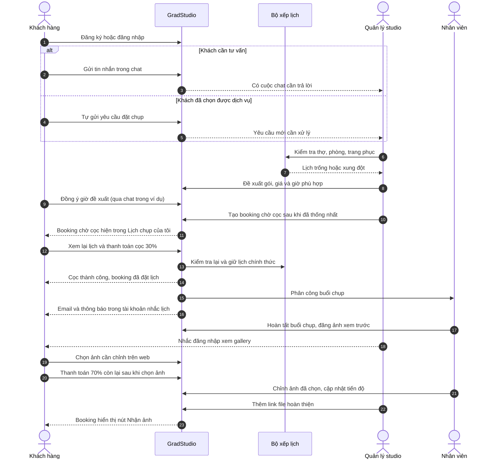

> Tài liệu nguồn PA01, chỉ dùng để tham khảo chức năng, dữ liệu và nguồn tài nguyên.
> Bố cục, màu, font và cách tương tác trong bản nguồn không phải quy ước UI PA02.
> Quy ước hiện hành: DESIGN.md và AGENTS.md ở gốc repo.

# GradStudio – Hệ thống đặt lịch và quản lý buổi chụp từ lúc tư vấn đến khi giao ảnh

## Nhóm thực hiện

| Mã sinh viên | Họ và tên |
| --- | --- |
| 23120192 | Nguyễn Nhật Vy |
| 23120193 | Trần Kim Yến |
| 23120201 | Nguyễn Thị Trúc Hằng |

## Vấn đề cần giải quyết

Nhiều studio giới thiệu dịch vụ trên mạng xã hội rồi tư vấn, chốt lịch qua Facebook hoặc Zalo; khách mới phải tự tìm từng bài đăng, khó xem gói, ảnh mẫu và đánh giá ở cùng một nơi để quyết định. Khách cần biết giá tham khảo, lịch nào đã được đặt chắc và từng mốc phải đến studio như makeup, chụp ảnh; nếu chỉ dựa vào tin nhắn cũ, họ dễ quên giờ hoặc bỏ sót thay đổi. Với quản lý studio, việc dò hội thoại rồi đối chiếu lịch thợ chụp, thợ makeup, phòng và trang phục dễ gây hẹn trùng; nhân viên cũng khó theo dõi việc được giao. Sau buổi chụp, ảnh khách chọn và link giao file lại nằm rải rác trong tin nhắn. GradStudio gom dịch vụ, ảnh mẫu, đánh giá và tư vấn vào website, rồi gắn mọi bước với **một booking xuyên suốt**: hai bên chốt giờ qua chat sau khi kiểm tra tài nguyên, khách xem lại lịch và cọc 30% để đặt chắc, nhận nhắc hẹn qua email lẫn tài khoản, sau đó chọn và nhận ảnh tại chính booking đó.

## Người dùng

| Vai trò | Việc họ muốn làm |
| --- | --- |
| Superadmin/quản trị hệ thống | Tạo và quản lý tài khoản Admin; thiết lập cấu hình chung của hệ thống như giờ hoạt động và thời điểm nhắc hẹn. |
| Khách hàng | Xem gói, ảnh mẫu và đánh giá để chọn dịch vụ; hỏi hoặc tự gửi yêu cầu, thống nhất giờ chụp, cọc 30% để đặt lịch, nhận nhắc hẹn qua email/tài khoản, chọn ảnh cần chỉnh và nhận file. Với kỷ yếu lớp, một người đại diện quản lý booking. |
| Admin/quản lý studio | Biến cuộc tư vấn thành booking, chọn giờ không trùng thợ/phòng, phân công và theo dõi các buổi sắp chụp, đổi/hủy lịch, theo dõi trạng thái thanh toán. |
| Nhân viên studio | Biết khi nào và ở đâu mình phải chụp, makeup hoặc chỉnh ảnh; cập nhật phần việc, đưa ảnh xem trước lên booking và hoàn thiện ảnh khách chọn. |

## Luồng chính của toàn hệ thống

Superadmin tạo tài khoản Admin và thiết lập cấu hình chung trước khi studio vận hành; vai trò này không tham gia xử lý từng booking trong luồng dưới đây.

1. Khách xem portfolio, đánh giá của khách trước, loại buổi chụp và gói dịch vụ; sau khi đăng nhập, khách **chat trực tiếp với studio hoặc tự gửi yêu cầu đặt chụp**. Yêu cầu có loại buổi chụp, thời gian mong muốn và dịch vụ thêm như makeup hoặc thuê trang phục.
2. Admin tiếp nhận cuộc chat hoặc yêu cầu, tư vấn gói và giá. Hệ thống kiểm tra lịch của từng nhân viên và tài nguyên theo đúng khoảng thời gian cần dùng; khi bị trùng, hệ thống báo lý do và gợi ý giờ khác. Với khách đang tư vấn qua chat, Admin đề xuất giờ mới và khách đồng ý hoặc từ chối ngay trong chat; form booking đã có sẵn nhưng chưa thể tạo booking trước khi khách chốt. Sau đó Admin tạo booking gắn với cuộc trò chuyện, trạng thái **Chờ cọc 30%**. Nếu khách tự gửi yêu cầu, Admin xử lý trong cùng quy trình; khi phải đổi giờ, studio trao đổi để khách đồng ý trước khi tạo booking.
3. Khách vào **Lịch chụp của tôi** để xem lại gói, giờ đã thống nhất trong chat, giá 1.800.000đ ở ví dụ demo và khoản cọc 30% (540.000đ), rồi thanh toán cọc qua cổng trực tuyến; khách không cần xác nhận giờ lần thứ hai. **Chỉ khi giao dịch cọc thành công và hệ thống kiểm tra lại tài nguyên**, booking mới chuyển từ **Chờ cọc** sang **Đã đặt lịch**, giữ lịch chính thức, phân công nhân viên và lập các mốc chuẩn bị. Nếu thanh toán chưa thành công, booking tiếp tục chờ cọc và chưa chiếm lịch chính thức. Lịch trong tài khoản hiển thị các mốc makeup, chụp ảnh; booking đã đặt được nhắc qua email và thông báo trong tài khoản 24 giờ trước mốc bắt đầu sớm nhất.
4. Nhân viên chuẩn bị, thực hiện buổi chụp và cập nhật trạng thái. Sau buổi chụp, nhân viên đưa ảnh xem trước dung lượng thấp vào gallery của đúng booking; khách đăng nhập để chọn số ảnh cần chỉnh theo gói.
5. Sau khi buổi chụp kết thúc và khách đã chọn ảnh cần chỉnh từ gallery xem trước, khách thanh toán 70% còn lại qua cổng trực tuyến (1.260.000đ trong ví dụ demo); nhân viên chỉnh các ảnh khách chọn và cập nhật tiến độ. Khi đã nhận đủ tiền và ảnh hoàn thiện, Admin thêm đường dẫn file; khách vào booking để bấm **Nhận ảnh**. Buổi chụp chuyển sang **Hoàn thành**. Nếu hủy hoặc đổi lịch, Admin phải kiểm tra lại tài nguyên ở giờ mới và cập nhật các công việc liên quan. Ba màn PA#1 chưa minh họa bước trả 70% và nhận ảnh.

### Sơ đồ luồng chính

## Phạm vi làm trong học kỳ

**Sẽ xây dựng trong học kỳ:**

- Một studio với danh mục gói, dịch vụ thêm, ảnh mẫu, đánh giá khách hàng và dữ liệu mẫu về nhân viên, phòng, trang phục.
- Tài khoản Khách hàng, Nhân viên, Admin và Superadmin; Superadmin tạo/quản lý tài khoản Admin và cấu hình chung của hệ thống.
- Chat tư vấn hoặc khách tự gửi yêu cầu; Admin kiểm tra trùng lịch theo người và tài nguyên, gợi ý giờ khác, tạo booking sau khi khách đồng ý giờ, phân công, đổi/hủy lịch.
- Khách xem lịch đã thống nhất và trạng thái chờ cọc/đã đặt lịch; nhân viên xem công việc được giao; nhắc các mốc hẹn qua email và thông báo trong tài khoản khách.
- Cổng thanh toán trực tuyến cho cọc 30% trước khi giữ lịch chính thức và 70% còn lại sau buổi chụp; khách xem, Admin theo dõi trạng thái thanh toán của booking.
- Gallery ảnh xem trước theo booking, khách chọn ảnh cần chỉnh, nhân viên cập nhật tiến độ và giao ảnh hoàn thiện bằng link.

**Không xây dựng trong học kỳ (Not building):**

- Sàn so sánh hoặc đặt dịch vụ từ nhiều studio/nhà cung cấp độc lập.
- Crawl giá, đánh giá hay lịch trống của các bên ngoài.
- Đồng bộ tự động tin nhắn Zalo/Facebook vào cuộc chat GradStudio hoặc gửi SMS nhắc hẹn.
- Ứng dụng iOS/Android riêng; khách và nhân viên dùng website trên điện thoại nếu cần.
- Hệ thống quản lý nhiều chi nhánh/studio với dữ liệu nhân sự, kho đồ và doanh thu riêng cho từng nơi.
- Chỉnh ảnh tự động bằng AI hoặc nhận diện khuôn mặt để phân loại ảnh.

## Ba màn hình của prototype

Ba màn hình minh họa **giai đoạn tư vấn, thống nhất giờ và đặt cọc để giữ lịch**, là đoạn đầu và là điểm nhấn chống trùng tài nguyên trong luồng toàn hệ thống ở trên. Ví dụ xuyên suốt: Linh muốn chụp tốt nghiệp có makeup ngày 24/10/2026 lúc 09:00; thợ makeup đã có lịch, nên studio đề xuất makeup 13:00–14:00 và chụp 14:00–16:00. Linh chốt giờ trong chat, sau đó xem booking và cọc 30% (540.000đ trên giá gói 1.800.000đ). Các bước phân công, chụp, trả 70% còn lại, chọn ảnh và giao file thuộc phạm vi hệ thống nhưng không xuất hiện trong ba màn PA#1.

### Màn 1 — Trang dịch vụ và chat của khách

Linh muốn tìm gói phù hợp và hỏi liệu có thể chụp lúc 09:00. Linh xem trang giới thiệu, bấm **Xem gói chụp** để cuộn tới các thẻ dịch vụ hoặc mở **Chat với studio**; khung chat đang hiện câu hỏi “Gói tốt nghiệp có makeup còn lịch 24/10 lúc 09:00 không?” và phản hồi studio sẽ kiểm tra. Tin nhắn của Linh là đầu vào cho cuộc hội thoại Admin mở ở Màn 2. Các thẻ dịch vụ nằm phía dưới phần đầu trang trong prototype.

### Màn 2 — Admin tư vấn và xử lý trùng lịch

Admin Thảo muốn tìm giờ đủ người và phòng rồi chốt trực tiếp với Linh trong chat. Thảo nhìn danh sách khách bên trái, cuộc chat và form **Booking mới** bên dưới chat ở cột giữa, lịch tài nguyên bên phải. Ban đầu 09:00 báo trùng vì Mai bận 08:00–12:00, nên nút **Tạo booking** trong form có sẵn bị vô hiệu hóa. Thảo bấm **Chọn 14:00**; chat hiện đề xuất makeup 13:00–14:00, chụp với Tuấn và Phòng B 14:00–16:00. Người xem bấm **Chốt giờ này** trong phần **Mô phỏng phản hồi của Linh** để chat thêm câu **“Dạ em chốt lịch 14:00 ạ.”** Hội thoại đổi từ **Đang tư vấn** sang **Đã chốt lịch**; chỉ lúc này nút **Tạo booking** được bật. Trong form, **Tốt nghiệp cá nhân** là loại buổi chụp, còn **Gói Tốt nghiệp Premium** là gói dịch vụ giá 1.800.000đ. Thảo cuộn tới form ở vị trí cũ, tạo booking GS-1024 gắn với chat; booking **Chờ cọc 30%** xuất hiện trong tài khoản Linh và prototype tự chuyển sang Màn 3 sau khoảng 2 giây. Các hội thoại khác giữ nguyên hành vi; **Gửi báo giá vào chat** chỉ thêm tóm tắt gói vào cuộc trò chuyện. Hướng dẫn các bước bấm và nhánh từ chối nằm trong [LINK.md](LINK.md).

### Màn 3 — Xem lại lịch và thanh toán cọc

Linh muốn kiểm tra lại giờ đã chốt trong chat và trả cọc để giữ lịch. Trong **Lịch chụp của tôi**, lịch tuần đánh dấu 24/10; timeline gạch giờ 09:00 không thực hiện được, rồi hiển thị makeup với Mai 13:00–14:00 và chụp với Tuấn 14:00–16:00. Thẻ bên phải ghi **Đã thống nhất lịch · Chờ cọc 30%**, **Gói Tốt nghiệp Premium**, giá **1.800.000đ**, cọc **540.000đ** và còn lại **1.260.000đ, thanh toán sau buổi chụp**; Linh bấm **Thanh toán cọc 30%** để mở hộp **Mô phỏng thanh toán** trên chính màn này. Nếu hủy, lịch vẫn chờ cọc; nếu mô phỏng thành công, trạng thái đổi thành **Đã đặt lịch**. Đây là tương tác demo, chưa phải cổng thanh toán thật; triển khai cổng thanh toán trực tuyến là phần nhóm dự kiến xây trong học kỳ. Các tab lọc chỉ đổi danh sách lịch trên cùng màn; bản đồ bên dưới minh họa vị trí studio, còn **Xem đường đi** chưa mở bản đồ thật.

## Minh chứng prototype

Link công khai và đường dẫn trực tiếp từng màn nằm trong `LINK.md`. Ba ảnh chính nằm cùng thư mục với tài liệu này; hai ảnh cho thấy các vị trí cuộn của Màn 2 nằm trong `reference/`. Nút **Màn 1 / Màn 2 / Màn 3** ở góc dưới là lối chuyển vai trò để người xem theo dõi ba trạng thái; **Đặt lại demo** ở Màn 2 và Màn 3 chỉ khôi phục dữ liệu minh họa của từng màn. Các mục menu studio khác, menu tài khoản, link thư viện/chân trang và **Xem đường đi** là phần ngoài ba màn PA#1 hoặc chỗ giữ chỗ, không đại diện cho chức năng đã hoàn thành. Email nhắc hẹn, cổng thanh toán thật, trả 70% còn lại và quản lý công việc nhân viên thuộc phạm vi hệ thống sẽ xây trong học kỳ, chưa xuất hiện trong prototype này.
